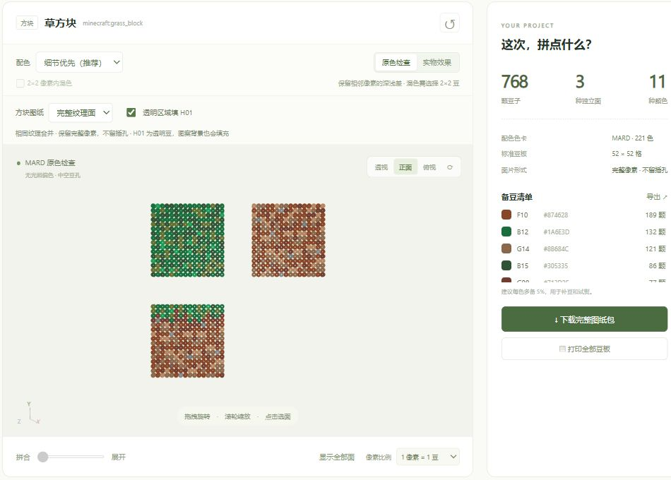

# MC3DBeads · 把方块世界拼进现实

一个 Minecraft 立体拼豆工作台。挑选喜欢的方块、物品或生物，把熟悉的像素图案变成 MARD 色号图纸，再一颗颗拼成手里的作品。

网站收录 **Minecraft Java 1.21.1 的 2,523 个目录项**，使用 **MARD 221 色卡**，提供可旋转的 3D 拼豆预览、52×52 豆板排版、备豆清单和图纸导出。源码、游戏素材、模型与 Windows/macOS 运行依赖一起保存在本仓库，下载后即可在本机离线使用。



## 从一个模型开始

在左侧按 **方块、物品、实体** 浏览，也可以搜索中文名、英文名或 Minecraft ID。目录包含 1,060 个方块、1,333 个物品和 130 个实体类型。

- **方块**：选择“立体拼插”，查看组装模型和带凸齿、插槽的面片；切换“完整纹理面”，相同图案合并展示，保留完整的像素边缘。草方块会展开为顶面、底面和侧面三张 16×16 图纸。
- **物品**：使用原版手持形态，运输船、矿车、工具与武器都能直接转成拼豆图案。
- **实体**：浏览生物和其他实体的静态模型，通过“展开”滑杆查看部件；展示实体支持选择物品、方块、文字或画作内容。

拖拽模型旋转，滚轮缩放，点击一个面即可联动对应图纸。顶部按钮可快速切换透视、正面和俯视；收藏喜欢的模型，方便下次继续。

## 配色与透明豆

默认的 **细节优先** 使用 CIEDE2000 色差和纹理明暗关系选豆色，让矿石、泥土、草皮与生物面部的层次更清楚。还可以切换“原色近似”和“旧版配色”，对照自己喜欢的效果。

**H01 是透明豆，H02 是白色。** 勾选“透明区域填 H01”，可以把玻璃等图案的透明格填成透明豆。图纸用棋盘格标识 H01，备豆清单分别统计每一种色号。

“原色检查”方便对照色卡，“实物效果”呈现中性光照下的豆子材质。选择 **1 像素 = 2×2 豆** 后，还可开启像素内混色，用四颗豆组合出更接近原纹理的整体颜色。

[配色对照](docs/color-comparison.png) · [透明玻璃示例](docs/transparent-glass-preview.png) · [手持物品示例](docs/held-item-preview.png)

## 铺豆、拼插与导出

1. 选好模型、配色、像素比例和图纸模式。
2. 按备豆清单准备 MARD 豆子，每种颜色可多备一些用于补豆和试熨。
3. 按 52×52 豆板坐标铺豆：色号格放对应豆子，H01 棋盘格放透明豆，叉线插槽和空白格留空。
4. 轻熨固定面片，冷却后按 P 面片编号与 S 接缝配对组装。

可下载当前豆板 SVG、导出用量 CSV、打印全部豆板，或一次下载完整 ZIP 图纸包。完整包包含 **所有豆板、备豆清单、装配对应关系、3D 预览图和项目 JSON**，也保存本次配色与透明填充设置。

完整纹理面模式按每种独立图案一份统计用量。需要多份相同面时，按制作数量准备即可。打印垫图可根据自己的豆板间距调整缩放比例。

## Windows 启动

双击 **`双击启动本地网站.cmd`**。首次启动会展开项目附带的运行时，随后打开：

**http://127.0.0.1:4173**

再次启动会复用同一目录的服务。也可以在 PowerShell 指定端口，或只启动服务：

```powershell
.\启动.ps1 -Port 4174
.\启动.ps1 -NoBrowser
```

## macOS 启动

在 **macOS 13.5 或更新版本**上，双击 **`启动.command`**。脚本会自动选择 Apple Silicon 或 Intel 对应的本地运行时并打开网站。

也可在终端启动，中文或带空格的路径用引号括起：

```bash
bash "/你的路径/MC3DBeads/启动.command"
bash "/你的路径/MC3DBeads/启动.command" --port 4174 --no-browser
```

两种系统的服务都使用本机地址 `127.0.0.1`。启动日志和解包后的运行时保存在 `.cache/`。

## 项目结构

| 目录 | 内容 |
| --- | --- |
| `public/src/` | 网页、3D 预览、配色、分面与豆板算法 |
| `public/data/` | 原版目录、MARD 色卡、实体及特殊模型 |
| `public/minecraft/` | 纹理、模型、译名和物品缩略图 |
| `public/vendor/` | 浏览器使用的 Three.js 渲染库 |
| `vendor/node/` | 构建、测试与素材审核的本地依赖 |
| `runtime/` | Windows 与两种 macOS 架构的运行包和校验清单 |
| `references/` | MARD 色卡与立体拼豆样例 |
| `scripts/`、`tests/` | 服务、构建、素材维护及测试 |
| `docs/` | 示例截图、模型来源与覆盖报告 |
| `dist/` | 构建生成的静态网站副本 |

## 本地开发

项目使用原生 JavaScript、Three.js 和 Node.js。开发依赖直接从仓库内准备：

```bash
node scripts/prepare-dependencies.mjs
node --test tests/*.test.mjs
node scripts/build.mjs
node scripts/verify-portable.mjs
node scripts/server.mjs --port 4174
```

`node` 可以使用系统命令，也可以使用启动脚本已展开到 `.cache/runtime/` 的便携版本。素材维护脚本支持从本地 Minecraft 1.21.1 资源重新导入，Python、Java 与 Gradle 工具路径通过脚本参数配置。日常浏览、配色、排板和导出直接使用仓库内整理好的资源。

## 来源与许可

项目代码采用 [Apache-2.0](LICENSE)。Minecraft 模型、纹理与译名来自 Java 1.21.1，相关权利归 Mojang / Microsoft；MARD 对照表和拼豆样例来自用户提供的参考资料。第三方软件使用各自的许可证，详见 [资源与许可证说明](THIRD_PARTY_NOTICES.md)。

[GitHub 仓库](https://github.com/KevinWuSZMS/Minecraft-3d-Beads) · [物品模型来源](docs/item-model-coverage.json) · [完整纹理面覆盖](docs/texture-face-coverage.json)
